# Zbigniew Zabost

Site reliability engineer in Berlin. I work on Kubernetes platforms across AWS, Azure and GCP: GitOps delivery, infrastructure as code, observability, and lately AI agents for routine operations, with deterministic checks deciding and humans owning production.

I started in test automation, and it still shows. I'd rather prove that a safeguard works than assume it does.

All my code happens in private repositories, so there isn't much to browse here. The short version of my path is on [my personal page](https://zbigniewzabost.github.io).

Day to day: Kubernetes · Helm · Argo CD · Terraform · Prometheus · Grafana · OpenTelemetry · Tailscale · Bash · Python · Go · Claude Code

[Personal page](https://zbigniewzabost.github.io) · [LinkedIn](https://www.linkedin.com/in/zabostz)
